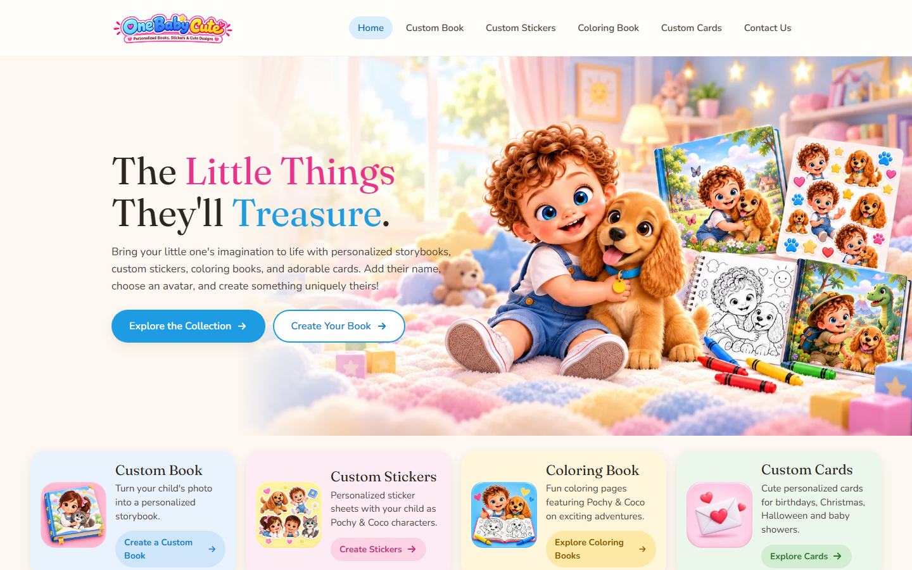
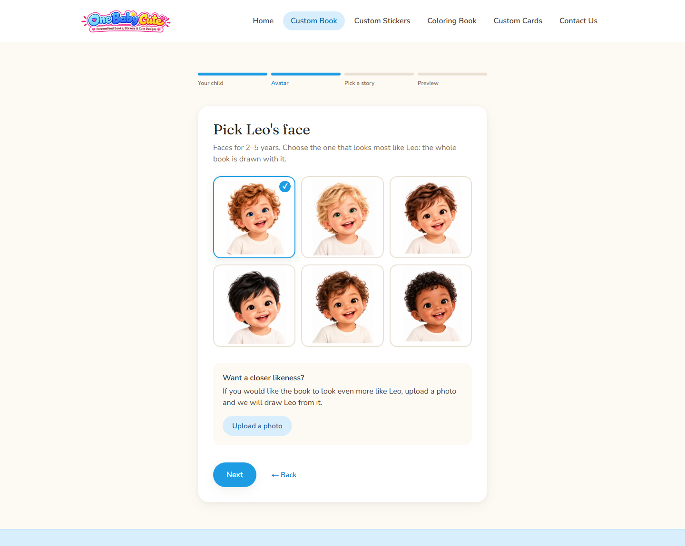
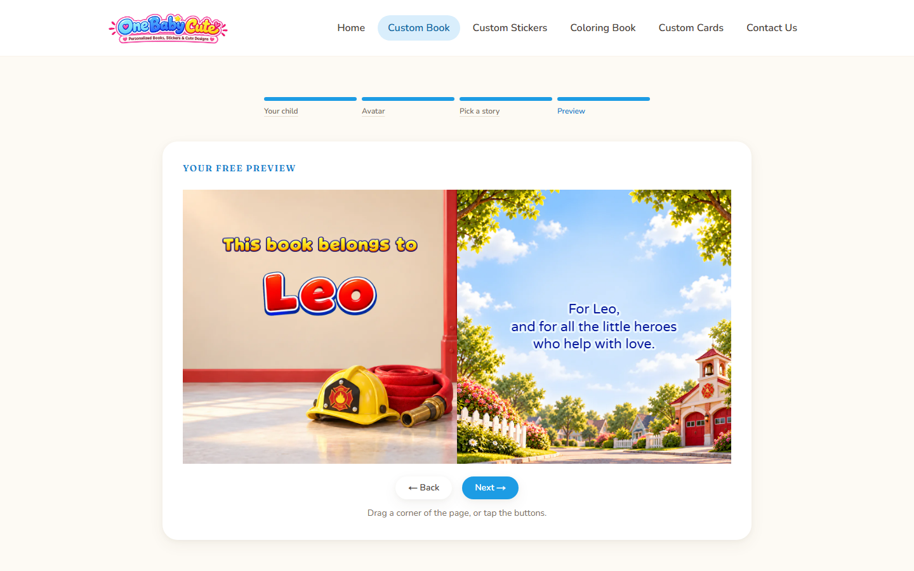
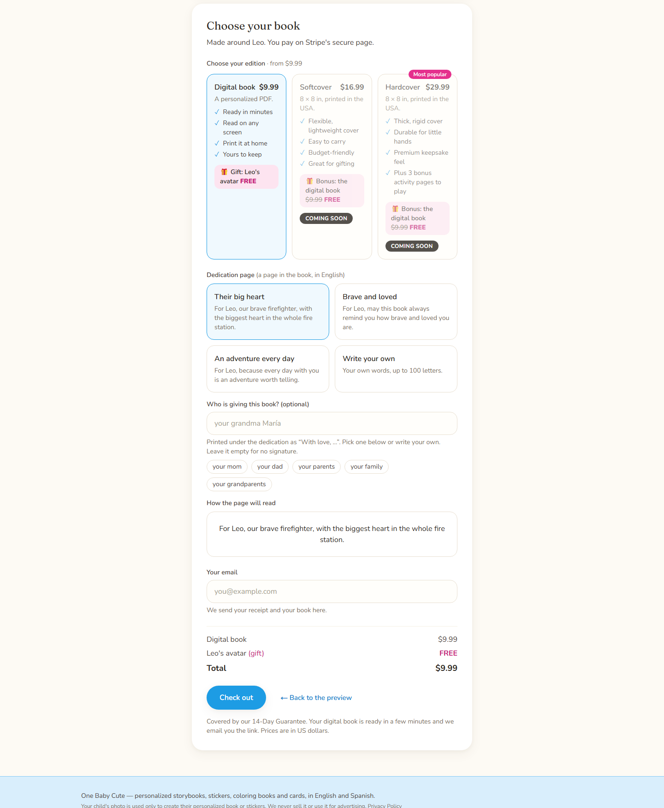

# One Baby Cute — Showcase

A personalized-products shop for children, built end to end as a solo project with [Claude Code](https://claude.com/claude-code): custom storybooks, stickers, digital cards and invitations, and coloring books, where a child's illustrated avatar is placed into ready-made artwork.

Live: **[onebabycute.com](https://onebabycute.com)** · App: **[app.onebabycute.com](https://app.onebabycute.com)**

> The source code is private because this is a production product. This repository documents what it does, how it is built, and the decisions behind it. I'm happy to walk through the code on a call.

---

## What it does

1. **Create an avatar.** The customer picks a face (or uploads an optional photo) and the app generates a cartoon avatar of their child.
2. **Preview for free.** A short sample of the book is rendered with that avatar so the customer sees the result before paying.
3. **Pay.** Stripe Checkout creates the order; a signed webhook marks it paid.
4. **Compose and deliver.** Only after payment, the full product is composed and delivered by email as a secure, expiring link (digital) or sent to a print-on-demand partner (physical).

Products: personalized storybooks (digital and print), custom stickers, digital cards and invitations, and coloring books. A second sales channel (Etsy) is served by a small admin tool that produces the same files without the web checkout.

## Screenshots

| | |
| --- | --- |
| **Home** — the four product lines<br> | **Pick a face** — six ready-made faces, with an optional photo upload<br> |
| **Finished example book** — opens like a real book (drag a corner or tap Next)<br> | **Free personalized preview** — the child's name inside the artwork<br> |

**Order options** — edition, dedication page and total, before handing off to Stripe's hosted payment page (not shown here):



## Architecture

Two separate services, on purpose:

```
┌──────────────────────────┐        ┌────────────────────────────────┐
│  Web  (Next.js 16)       │  HTTPS │  API  (Express, Node 24)       │
│  React 19 · TypeScript   │ ─────► │  Orders · Stripe · AI images   │
│  Tailwind 4              │        │  PDF / print files · Email     │
│  Book viewer, shop, SEO  │        │  SQLite (node:sqlite)          │
└──────────────────────────┘        └───────────────┬────────────────┘
                                                    │
              OpenAI · Gemini · Stripe · Resend · print-on-demand API
```

- **Web:** storefront, story pages, a page-flip book viewer, the checkout flow and order pages.
- **API:** everything that costs money or needs secrets — image generation, payments, order state, file composition, email, print files.
- Each service has its own Dockerfile and is deployed from GitHub to a VPS.

## Tech stack

| Area | Tools |
| --- | --- |
| Frontend | Next.js 16 (App Router), React 19, TypeScript, Tailwind CSS 4, page-flip |
| Backend | Node.js 24, Express, `node:sqlite`, multer |
| Payments | Stripe Checkout + signature-verified webhooks |
| AI | OpenAI (text, images) and Gemini image models for the child's avatar |
| Images & print | sharp, pdfkit, opentype.js (title lettering), ffmpeg for book videos |
| Email | Resend (verified domain) |
| Deploy | Docker, VPS, DNS split between landing page and app subdomains |

## Engineering decisions worth a look

- **Draw once, personalize many times.** Books are illustrated a single time. For each customer only the child's avatar is composited into the existing artwork, which keeps AI cost per order low and the output consistent.
- **Free previews can't drain the AI budget.** Generation endpoints are rate-limited per IP, per hour and per day, with a global cap, because a per-IP limit alone doesn't protect against traffic from many addresses.
- **Payment is trusted only from Stripe.** Orders are marked paid by the signature-verified webhook, never by the browser's redirect. The expensive full-book composition runs only after that.
- **Expiring, signed links.** Previews and downloads use HMAC-signed URLs with an expiry instead of guessable IDs.
- **Recoverable fulfilment.** Order dispatch can be retried from an admin route, so a failed email or print step doesn't lose a paid order.
- **Print-ready output.** Files are generated at a fixed print resolution and page size, with cover title lettering kept inside the printer's safe zone by code.
- **Secrets stay out of git.** Configuration is through environment variables with a documented `.env.example`; test-mode Stripe keys are used in development.

## How I built it with Claude Code

Claude Code was my main development tool for both services: planning features, writing and refactoring code, debugging deploys, and writing validation scripts (for example checks that every story and catalog entry is complete before it ships). Four real problems that came up along the way:

1. **Generation timed out behind the hosting proxy.** The first version generated the whole story inside one POST request; it took minutes and the proxy cut it with a 504. Fix: the endpoint returns an ID immediately, generation runs in the background, and the browser polls a status endpoint every few seconds to draw a progress bar.
2. **Files vanished on every deploy.** Generated images were first written to disk, but on hosts with ephemeral disks they disappeared on each deploy or restart, which showed up as broken images. Fix: images live in memory for a limited time, and anything that must last (orders, customer emails) goes in a SQLite database on persistent storage.
3. **Free previews could burn real money.** Every preview calls a paid AI API. Fix: rate limits per IP, per hour and per day, plus a global cap, because a per-IP limit alone doesn't stop traffic spread over many addresses.
4. **Anyone could have claimed to be "paid".** Marking an order paid must not depend on the browser. Fix: the order is confirmed only by Stripe's webhook, verified with its signing secret; the expensive full-book composition starts only after that.

**In plain words:** at first, generating a story took minutes inside a single request and the hosting server cut it off with a 504 error, so the app now replies right away, keeps generating in the background, and the browser checks progress every few seconds. Images used to be saved on a disk that is wiped on every update, so they showed up broken; now they live briefly in memory, and anything that must last (orders, customer emails) goes in a database on permanent storage. Every free preview costs real money because it uses a paid AI service, so I added limits per person, per hour and per day, plus an overall cap, so even a busy campaign can't drain the balance without anyone buying. And so nobody can claim "I already paid" without paying, an order is marked as paid only when Stripe confirms it with a secret signature, never because the browser says so, and the full book is built only after that.

## Scale

Roughly 11,000 lines of JavaScript in the API and 12,000 lines of TypeScript in the web app, plus build and print-pipeline scripts.

## Contact

[github.com/Ailensrivas](https://github.com/Ailensrivas)
